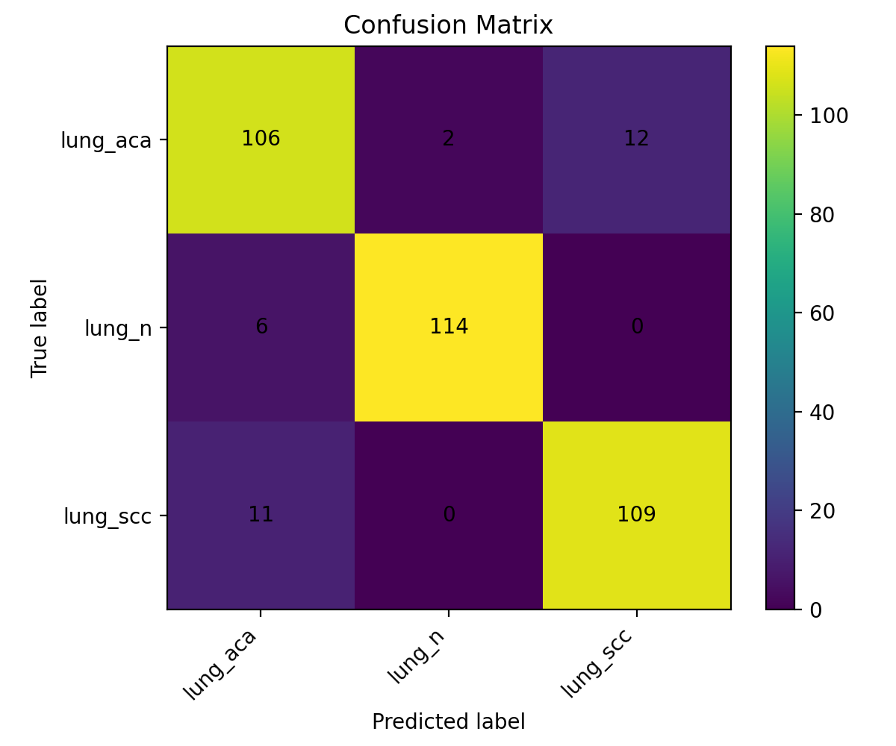
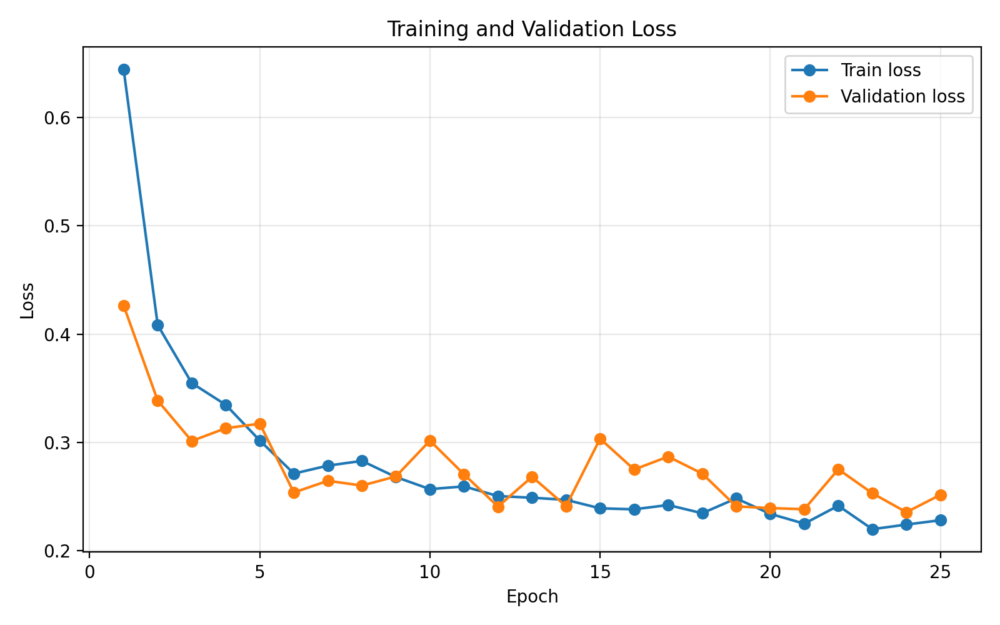

# Lung Tissue Image Classification with CNNs

## Overview

This project uses convolutional neural networks to classify lung histopathology images into three classes: adenocarcinoma, normal lung tissue, and squamous cell carcinoma. It was developed for a university machine-learning assignment using PyTorch and includes a compact baseline CNN, two comparison architectures, and the corresponding training and evaluation pipeline.

## Dataset

The project uses a 2,400-image subset of the [LC25000 (Lung and Colon Cancer Histopathological Image Dataset)](https://github.com/tampapath/lung_colon_image_set), containing its three lung tissue classes: `lung_aca`, `lung_n`, and `lung_scc`. The subset was provided for the course and contains 800 images per class, stored as 128 × 128 RGB JPEGs.

The original LC25000 dataset contains 25,000 histopathology images across five lung and colon tissue classes, with 5,000 images per class. The dataset itself is not included in this repository.

Dataset reference: Borkowski et al. (2019), [Lung and Colon Cancer Histopathological Image Dataset (LC25000)](https://arxiv.org/abs/1912.12142).

All 2,400 local images were verified as RGB JPEGs measuring 128 × 128 pixels:

| Class | Images | Train | Validation | Test |
|---|---:|---:|---:|---:|
| `lung_aca` (adenocarcinoma) | 800 | 560 | 120 | 120 |
| `lung_n` (normal tissue) | 800 | 560 | 120 | 120 |
| `lung_scc` (squamous cell carcinoma) | 800 | 560 | 120 | 120 |
| Total | 2,400 | 1,680 | 360 | 360 |

`ImageFolder` assigns labels as `lung_aca=0`, `lung_n=1`, `lung_scc=2`. The code makes a stratified 70%/15%/15% split in two stages with seed 42. A warned random-split fallback exists for datasets too small for stratification; it was not used here.

An audit found 22 exact duplicate image pairs, with 11 crossing split boundaries (six train/validation, four train/test, one validation/test), causing data leakage. [Duplicate image evidence](reports/duplicate_images.json) records the filenames, hashes, and split membership.

## Model

The baseline model and training/evaluation pipeline in this repository were implemented by me.

The baseline `SimpleLungCNN` has **23,779 trainable parameters**. Three 3 × 3 convolution layers with 16, 32, and 64 channels are each followed by ReLU and 2 × 2 max pooling. Global average pooling, dropout with probability 0.3, and a linear layer produce three logits. No pretrained weights are used.

The `teammate` comparison (`TeammateCNN`) is based on a teammate's draft and uses 5 × 5 convolutions and a larger fully connected classifier. The `improved` comparison uses two convolutions per block, 32/64/128 channels, batch normalization, global average pooling, and dropout with probability 0.4.

## Training

The original runs used 25 epochs, batch size 32, Adam with learning rate 0.001, and cross-entropy loss. Training images are resized to 128 × 128, randomly flipped horizontally with probability 0.5, and randomly rotated by up to 10 degrees. Tensors use normalization mean `[0.485, 0.456, 0.406]` and standard deviation `[0.229, 0.224, 0.225]`.

Validation, test, and prediction use the same resizing and normalization without augmentation. The existing seed setup covers Python, NumPy, and PyTorch, with deterministic cuDNN settings and a seeded training-loader generator. Exact retraining across hardware or package versions is not established. There is no early stopping; the checkpoint with the lowest validation loss is saved.

## Evaluation

The best validation checkpoint is loaded and evaluated on the 360-image test split. Scikit-learn computes accuracy, macro precision, macro recall, macro F1, per-class metrics, and a confusion matrix. Macro F1 averages the three class F1 scores.

The test loader is not passed to training or checkpoint selection. The files cannot establish whether test results influenced manual choices between experiments. During the audit, all three original checkpoints reproduced their saved test labels, predictions, confusion matrices, and aggregate metrics.

## Results

These historical results use the original split; a later audit found exact duplicate images crossing split boundaries.

| Model | Trainable parameters | Test accuracy | Macro F1 | Best epoch |
|---|---:|---:|---:|---:|
| Baseline | 23,779 | 91.39% | 91.44% | 24 |
| Teammate | 2,046,571 | 94.17% | 94.14% | 22 |
| Improved | 287,843 | 97.50% | 97.49% | 24 |

The baseline correctly classified 329/360 test images: accuracy `0.9138888888888889`, macro F1 `0.9143646646023487`. Original metrics, predictions, probabilities, and training histories are preserved in `reports/test_metrics_<model_name>.json`.





## Project Structure

```text
lung-tissue-classification/
├── .gitignore
├── main.py
├── predict.py
├── requirements.txt
├── README.md
├── src/
│   ├── __init__.py
│   ├── dataset.py
│   ├── evaluate.py
│   ├── model.py
│   ├── model_factory.py
│   ├── model_improved.py
│   ├── model_teammate.py
│   ├── train.py
│   └── utils.py
├── models/
│   └── best_model_baseline.pt
└── reports/
    ├── class_distribution.csv
    ├── duplicate_images.json
    ├── test_metrics_baseline.json
    ├── test_metrics_improved.json
    ├── test_metrics_teammate.json
    └── figures/
        ├── baseline/
        ├── improved/
        └── teammate/
```

Each figure directory contains `accuracy_curve.png`, `loss_curve.png`, and `confusion_matrix.png`. Figures containing dataset images are excluded because redistribution rights are unknown.

The baseline checkpoint is included because it is only 100,469 bytes and permits inference without retraining. Alternative checkpoints (1,165,168 and 8,192,937 bytes) are excluded to keep the repository small; training generates them locally. Their original reports are retained.

## Running the Project

Run commands from the repository root.

1. Clone and enter the repository:

   ```bash
   git clone https://github.com/Nirmhoss/lung-tissue-classification.git
   cd lung-tissue-classification
   ```

2. Create an environment:

   ```bash
   python -m venv .venv
   ```

   Activate it with `.\.venv\Scripts\Activate.ps1` in Windows PowerShell, or `source .venv/bin/activate` on macOS/Linux, then install dependencies:

   ```bash
   python -m pip install -r requirements.txt
   ```

   Validation used Python 3.14.0 and these existing environment versions: PyTorch `2.12.0+cu126`, torchvision `0.27.0+cu126`, NumPy `2.4.6`, pandas `3.0.3`, scikit-learn `1.9.0`, matplotlib `3.10.9`, Pillow `12.2.0`. Requirements pin the tested base versions; CPU/CUDA wheels depend on the installation source. A fresh installation and other Python versions were not tested.

3. Obtain the course dataset and place its class folders here:

   ```text
   data/lung_subset_small/
   ├── lung_aca/
   ├── lung_n/
   └── lung_scc/
   ```

4. Re-evaluate the included checkpoint without training:

   ```bash
   python main.py --evaluate_only
   ```

   This uses the checkpoint's seed and image size, checks class labels, and writes `reports/reevaluated_metrics_baseline.json`, preserving original reports and plots. The same dataset files and ordering are required; the checkpoint has no dataset manifest.

5. Predict one image, replacing the placeholder with an existing image path:

   ```bash
   python predict.py --image_path path/to/image.jpeg
   ```

6. Repeat the original training procedure if needed:

   ```bash
   python main.py --data_dir data/lung_subset_small --epochs 25 --batch_size 32 --lr 0.001 --img_size 128 --seed 42 --model_name baseline
   ```

   This repeats the original split and overwrites that model's local checkpoint, metrics, and figures. Use `--model_name teammate` or `--model_name improved` for comparisons. `--data_dir` accepts a different dataset location. Both scripts support `--help`.

## Development Note

AI coding tools were used extensively during implementation. The resulting code was reviewed, tested, adapted, and evaluated by me as part of the project.

## Limitations

- A clean evaluation requires removing duplicates or keeping duplicate groups within a single split, followed by retraining and fresh evaluation.
- No patient, slide, or original-image grouping metadata is available. Overlap among related images or augmented variants cannot be ruled out through the exact-duplicate check.
- No external validation is present. The subset's upstream source and redistribution terms remain unverified.
- This educational model is not a clinical diagnostic system.
